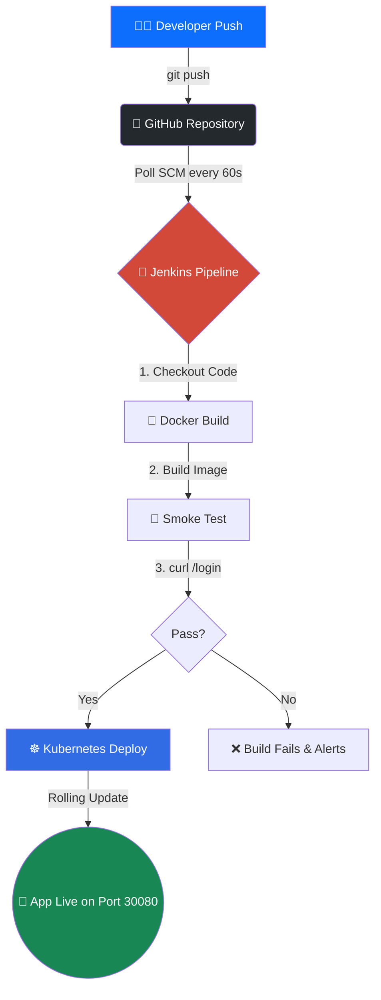

```markdown


<div align="center">

<a href="https://git.io/typing-svg">
  
</a>

<br><br>

[](https://www.jenkins.io/)
[](https://www.docker.com/)
[](https://kubernetes.io/)
[](https://www.python.org/)
[](https://flask.palletsprojects.com/)

<br><br>

**A production-grade, fully automated CI/CD pipeline running entirely on your local machine.** <br>
*Push code ➔ Jenkins builds & tests ➔ Docker containerizes ➔ Kubernetes deploys.*

</div>

---

## 🛠️ Technology Stack

<div align="center">
  <a href="https://skillicons.dev">
    
  </a>
</div>

---

## ✨ Enterprise Features

<details>
<summary><b>🔐 Secure Authentication & Roles</b> (Click to expand)</summary>
<br>
<ul>
  <li>Complete Login, Signup, and Logout flows using <code>Flask-Login</code>.</li>
  <li>Passwords securely hashed using <code>Werkzeug</code> security.</li>
  <li>Role-Based Access Control (RBAC): Admin vs. Standard User panels.</li>
</ul>
</details>

<details>
<summary><b>📊 Interactive & Dynamic Dashboard</b> (Click to expand)</summary>
<br>
<ul>
  <li>Real-time, animated charts powered by <code>Chart.js</code>.</li>
  <li>Responsive UI built with <code>Bootstrap 5</code>.</li>
  <li>Beautiful hover effects and custom CSS transitions.</li>
</ul>
</details>

<details>
<summary><b>🚀 Automated CI/CD Pipeline</b> (Click to expand)</summary>
<br>
<ul>
  <li>Jenkins pipelines as code (<code>Jenkinsfile</code>).</li>
  <li>Automatic trigger on Git push (SCM Polling).</li>
  <li>Built-in smoke testing using <code>curl</code> before deployment.</li>
  <li>Docker image tagging using the Jenkins <code>BUILD_NUMBER</code>.</li>
</ul>
</details>

<details>
<summary><b>☸️ Kubernetes Orchestration</b> (Click to expand)</summary>
<br>
<ul>
  <li>Declarative Kubernetes manifests (<code>deployment.yaml</code>, <code>service.yaml</code>).</li>
  <li>Self-healing: Auto-restarts failed pods.</li>
  <li>High Availability: Runs 2 replicas by default.</li>
  <li>Zero-downtime rolling updates.</li>
</ul>
</details>

---

## 🏗️ System Architecture



---

## 🚦 Quick Start Guide

### 1️⃣ Prerequisites
Ensure you have the following installed:
*   [Docker Desktop](https://www.docker.com/products/docker-desktop/) (Enable Kubernetes in settings)
*   [Git](https://git-scm.com/)
*   [Kubectl](https://kubernetes.io/docs/tasks/tools/)

### 2️⃣ Boot the Jenkins Server

```bash
cd jenkins-setup
docker compose up -d --build
```
> Access Jenkins at **`http://localhost:8080`** *(Get initial password via `docker exec jenkins cat /var/jenkins_home/secrets/initialAdminPassword`)*

### 3️⃣ Configure the Pipeline
1. Create a new **Pipeline** job in Jenkins.
2. Point it to your GitHub repository.
3. Set the script path to `Jenkinsfile`.
4. Add a **Secret File** credential named `kubeconfig` (upload your local `~/.kube/config` file).

### 4️⃣ Deploy & Access
Push any change to GitHub. Jenkins will automatically build and deploy.

```bash
# Watch the pods spin up!
kubectl get pods -w
```

🎉 **Access the live application at:** `http://localhost:30080`

**Default Admin Credentials:**
*   **Username:** `admin`
*   **Password:** `admin123`

---

## 📸 Application Previews

| 🔐 Login Page | 📊 Interactive Dashboard |
| :---: | :---: |
|  |  |

| 🛡️ Admin Panel | 📝 Sign Up Page |
| :---: | :---: |
|  |  |

---

## 📂 Project Structure

```text
flask-cicd-app/
├── 📁 jenkins-setup/        # Custom Jenkins Docker setup
├── 📁 k8s/                  # Kubernetes Manifests
│   ├── deployment.yaml      # Pod definitions
│   └── service.yaml         # NodePort service
├── 📁 static/               # CSS & JavaScript files
├── 📁 templates/            # HTML templates
├── 🐍 app.py                # Main Flask Application
├── 🐳 Dockerfile            # App Container
├── 🐳 docker-compose.yml    # Local runtime setup
├── ⚙️ Jenkinsfile           # CI/CD Pipeline
├── 📄 requirements.txt      # Python dependencies
└── 📖 README.md             # You are here!
```

---


```
